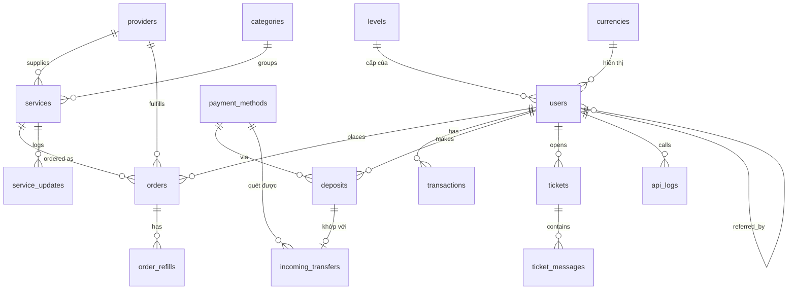

# Thiết kế Database – SMM Panel (Laravel + MySQL)

> Bản nháp v0.3 – chờ duyệt. Tham chiếu logic/API: smmraja.com (API v3, chuẩn PerfectPanel).

## 0. Các quyết định đã chốt
| # | Nội dung | Quyết định |
|---|---|---|
| 1 | Tiền tệ gốc | **USD**. Mọi số dư, giá, charge lưu bằng USD |
| 2 | Tiền tệ hiển thị | User chọn **USD / VND / THB** – chỉ quy đổi khi hiển thị, không lưu |
| 3 | Cổng nạp | **SePay** (chuyển khoản VND) + **Crypto tự quét** ví (không qua cổng trung gian) |
| 4 | Khớp nạp tiền | Phiếu nạp + quét giao dịch vào ví/TK → khớp phiếu → cộng tiền. Giao dịch không khớp được thì user dán mã giao dịch để nhận, hoặc admin gán tay |
| 5 | Đơn gửi provider thất bại | **Tự hoàn tiền** sau khi hết số lần retry |
| 6 | Dịch vụ làm tay | Chưa dùng nhưng **có sẵn trong schema** (`services.fulfillment = manual`) |
| 7 | API cho khách (reseller) | **Có** ngay từ MVP, tương thích chuẩn PerfectPanel, luôn trả USD |
| 8 | Cấp bậc / giảm giá | Bảng **`levels`**; giảm giá **chỉ theo cấp**, không có giảm giá riêng từng user |

## 1. Phân tích nhanh smmraja.com

### Tính năng phía user
| Nhóm | Tính năng quan sát được | Đưa vào MVP? |
|---|---|---|
| Dịch vụ | Danh sách dịch vụ theo Platform → Category, lọc/sort (giá, tốc độ, min/max, tỉ lệ drop), mô tả, yêu thích | ✅ (bỏ analytics) |
| Đặt đơn | Single order, **Mass order** (mỗi dòng `service_id\|link\|qty`), Drip-feed (`runs`, `interval`), các loại đặc biệt (custom comments, mentions, poll, web traffic `google_keyword`/`referring_url`…) | ✅ |
| Đơn hàng | Trạng thái, start_count, remains, lọc theo ngày/ID/link, **Refill**, **Cancel**, export CSV, danh sách refill | ✅ |
| Subscriptions | Auto-like: `username`, `posts`, `min`, `max`, `delay`, `expiry` | ⏳ Phase 2 |
| Nạp tiền | Nhiều cổng, QR, bonus % (crypto +5%), lịch sử nạp | ✅ SePay + Crypto |
| Biến động số dư | Mỗi đơn có `balance_before` / `balance_after` | ✅ |
| Cấp bậc | Giảm giá theo cấp | ✅ |
| Đa tiền tệ hiển thị | Hỏi user có muốn xem giá theo tiền địa phương | ✅ USD/VND/THB |
| Ticket | Loại: Refill / Cancel / Speed up / Payment / Other, bắt buộc order ID với loại liên quan đơn, đính kèm ảnh | ✅ |
| Updates | Log dịch vụ mới / tăng giá / giảm giá / tắt | ✅ |
| Tài khoản | Đổi mật khẩu, tạo API key (chỉ hiện 1 lần), 2FA, tiền tệ/múi giờ/ngôn ngữ | ✅ (2FA để sau) |
| API cho khách | `services`, `add`, `status`, `refill`, `refill_status`, `cancel`, `balance` | ✅ |
| Affiliate (Earn) | Hoa hồng giới thiệu, rút tiền | ⏳ Phase 2 |
| Child panel / Stores | Bán panel con, domain, gateway riêng | ❌ Ngoài phạm vi |

### API (smmraja dùng, mình clone lại cho khách)
`POST /api/v2` – form params `key`, `action`:

| action | Tham số | Response |
|---|---|---|
| `services` | – | `[{service, name, type, category, rate, min, max, refill, cancel, dripfeed}]` |
| `add` | `service`, `link`, `quantity`, `runs?`, `interval?` (+ tham số theo type) | `{order}` |
| `status` | `order` (1 ID) hoặc `orders` (nhiều ID, phẩy, tối đa 100) | `{charge, start_count, status, remains, currency}` |
| `refill` | `order` (hoặc `orders`) | `{refill}` |
| `refill_status` | `refill` (hoặc `refills`) | `{status}` |
| `cancel` | `orders` | `[{order, cancel}]` |
| `balance` | – | `{balance, currency: "USD"}` |

Status trả ra: `Pending | Processing | In progress | Completed | Partial | Canceled | Refunded`.
`rate` trong `services` trả **giá đã áp giảm giá cấp bậc** của chính user gọi API. API luôn dùng USD, không phụ thuộc tiền tệ hiển thị.

---

## 2. ERD

---

## 3. Chi tiết bảng

Quy ước chung:
- Tiền dùng `DECIMAL(18,6)`, đơn vị **USD** (rate có thể 0.001/1000 → charge rất nhỏ). **Không dùng float.**
- Tiền tệ khác chỉ xuất hiện ở: `currencies` (tỉ giá hiển thị), `deposits.paid_*` và `incoming_transfers.amount` (số tiền thực nhận).
- Trạng thái dùng `VARCHAR` + PHP Enum (dễ mở rộng hơn MySQL `ENUM`).

### 3.1 `levels` – cấp bậc
| Cột | Kiểu | Ghi chú |
|---|---|---|
| id | BIGINT UNSIGNED PK | |
| name | VARCHAR(50) | vd `Member`, `Silver`, `Gold`, `Reseller`, `VIP` |
| min_spent | DECIMAL(18,6) default 0 | Tổng chi tiêu (USD) để tự động lên cấp này |
| discount_percent | DECIMAL(5,2) default 0 | % giảm trên giá bán của mọi dịch vụ |
| auto_upgrade | BOOLEAN default 1 | 0 = cấp chỉ admin gán tay (vd cấp đại lý đặc biệt) |
| is_default | BOOLEAN default 0 | Cấp gán cho user mới đăng ký (đúng 1 cấp) |
| sort | INT default 0 | Thứ tự hiển thị |
| color | VARCHAR(20) NULL | Màu badge trên UI |
| timestamps | | |

Seed mẫu: Member (0$, 0%) · Silver (100$, 3%) · Gold (500$, 5%) · Diamond (2000$, 8%).

### 3.2 `currencies` – tiền tệ hiển thị
| Cột | Kiểu | Ghi chú |
|---|---|---|
| code | CHAR(3) PK | `USD`, `VND`, `THB` |
| name | VARCHAR(50) | “Đô la Mỹ”, “Việt Nam Đồng”, “Baht Thái” |
| symbol | VARCHAR(5) | `$`, `₫`, `฿` |
| symbol_position | VARCHAR(6) default `before` | `before` ($1.20) / `after` (30.000 ₫) |
| rate | DECIMAL(18,6) | Số đơn vị tiền này = 1 USD (USD = 1) |
| decimals | TINYINT UNSIGNED | Số chữ số thập phân khi hiển thị (USD 4, VND 0, THB 2) |
| auto_update | BOOLEAN default 1 | Cron cập nhật tỉ giá hằng ngày từ API tỉ giá; 0 = admin đặt tay |
| status | VARCHAR(20) default `active` | |
| updated_at | TIMESTAMP | |

Seed: USD (1) · VND (~25 500) · THB (~33) – số thực tế lấy lúc chạy cron.
Giá /1000 rất nhỏ nên khi hiển thị VND/THB có thể ra số lẻ; làm tròn **lên** khi hiển thị giá, nhưng **trừ tiền luôn theo USD**.

### 3.3 `users`
| Cột | Kiểu | Ghi chú |
|---|---|---|
| id | BIGINT UNSIGNED PK | |
| level_id | FK→levels | |
| currency | CHAR(3) FK→currencies.code default `USD` | Tiền tệ hiển thị |
| name | VARCHAR(100) | |
| username | VARCHAR(50) UNIQUE | |
| email | VARCHAR(191) UNIQUE | |
| email_verified_at | TIMESTAMP NULL | |
| password | VARCHAR(255) | |
| role | VARCHAR(20) default `user` | `user`, `admin` (quyền hệ thống, **khác** cấp bậc) |
| status | VARCHAR(20) default `active` | `active`, `banned` |
| balance | DECIMAL(18,6) default 0 | USD. Chỉ thay đổi qua service sổ cái, luôn `lockForUpdate()` |
| total_spent | DECIMAL(18,6) default 0 | Chi tiêu thực (charge − refund), dùng để xét lên cấp |
| api_key_hash | CHAR(64) UNIQUE NULL | SHA-256 của key; key chỉ hiện 1 lần lúc tạo |
| api_key_last4 | CHAR(4) NULL | Để user nhận diện key |
| api_key_created_at | TIMESTAMP NULL | |
| ref_code | VARCHAR(20) UNIQUE | Mã giới thiệu |
| referred_by | BIGINT UNSIGNED NULL FK→users | |
| timezone | VARCHAR(50) default `Asia/Ho_Chi_Minh` | |
| locale | VARCHAR(10) default `vi` | |
| last_login_at, last_login_ip | TIMESTAMP / VARCHAR(45) NULL | |
| remember_token | VARCHAR(100) NULL | |
| timestamps | | |

### 3.4 `providers` – nguồn upstream
| Cột | Kiểu | Ghi chú |
|---|---|---|
| id | BIGINT PK | |
| name | VARCHAR(100) | |
| api_url | VARCHAR(255) | vd `https://xxx.com/api/v2` |
| api_key | TEXT | Cast `encrypted` của Laravel |
| driver | VARCHAR(30) default `perfectpanel` | Để sau thêm driver khác |
| balance | DECIMAL(18,6) NULL | USD, cập nhật định kỳ, cảnh báo khi thấp |
| status | VARCHAR(20) default `active` | |
| last_synced_at | TIMESTAMP NULL | |
| note | TEXT NULL | |
| timestamps | | |

### 3.5 `categories`
| Cột | Kiểu | Ghi chú |
|---|---|---|
| id | BIGINT PK | |
| platform | VARCHAR(30) INDEX | `instagram`, `tiktok`, `youtube`, `facebook`, `telegram`, `twitter`, `spotify`, `other` |
| name | VARCHAR(191) | vd “TikTok Followers – Real” |
| sort | INT default 0 | |
| status | VARCHAR(20) default `active` | |
| timestamps | | |

### 3.6 `services`
| Cột | Kiểu | Ghi chú |
|---|---|---|
| id | BIGINT PK | **Chính là Service ID public** trả ra API |
| category_id | FK→categories | |
| fulfillment | VARCHAR(10) default `api` | `api` = gửi provider, `manual` = admin xử lý tay |
| provider_id | FK→providers NULL | Bắt buộc khi `fulfillment = api` |
| provider_service_id | VARCHAR(50) NULL | ID bên provider |
| name | VARCHAR(255) | |
| description | TEXT NULL | |
| type | VARCHAR(40) default `default` | `default`, `package`, `custom_comments`, `mentions_with_hashtags`, `mentions_custom_list`, `comment_likes`, `poll`, `subscriptions`, `web_traffic`… |
| rate | DECIMAL(18,6) | Giá bán gốc / 1000 (trước giảm cấp bậc) |
| provider_rate | DECIMAL(18,6) NULL | Giá vốn / 1000 (đồng bộ từ provider) |
| min | INT UNSIGNED | |
| max | INT UNSIGNED | |
| refill | BOOLEAN default 0 | |
| refill_days | SMALLINT UNSIGNED NULL | Bảo hành refill bao nhiêu ngày |
| cancel | BOOLEAN default 0 | |
| dripfeed | BOOLEAN default 0 | |
| average_time | INT UNSIGNED NULL | Phút, tính từ các đơn đã hoàn thành |
| sort | INT default 0 | |
| status | VARCHAR(20) default `active` | `active`, `disabled` |
| timestamps, deleted_at | | Soft delete vì order còn tham chiếu |

Index: `(category_id, status, sort)`, `(provider_id, provider_service_id)`.

> Lưu ý lãi: `rate × (1 − discount cấp cao nhất)` không được thấp hơn `provider_rate`. Trang admin cảnh báo khi đặt `rate` quá sát giá vốn.

### 3.7 `orders`
| Cột | Kiểu | Ghi chú |
|---|---|---|
| id | BIGINT PK | Order ID public |
| user_id | FK→users | |
| service_id | FK→services | |
| provider_id | FK→providers NULL | Snapshot lúc đặt; NULL = đơn làm tay |
| provider_order_id | VARCHAR(50) NULL | |
| link | VARCHAR(1000) | |
| quantity | INT UNSIGNED | |
| rate | DECIMAL(18,6) | Snapshot giá bán /1000 lúc đặt |
| discount_percent | DECIMAL(5,2) default 0 | Snapshot % giảm của cấp lúc đặt |
| charge | DECIMAL(18,6) | Tiền trừ user |
| cost | DECIMAL(18,6) NULL | Giá vốn → báo cáo lợi nhuận |
| start_count | INT UNSIGNED NULL | |
| remains | INT UNSIGNED NULL | |
| status | VARCHAR(20) default `pending` | `pending`, `processing`, `in_progress`, `completed`, `partial`, `canceled`, `refunded` |
| runs | INT UNSIGNED NULL | Drip-feed |
| interval | INT UNSIGNED NULL | Drip-feed (phút) |
| extra | JSON NULL | Tham số theo type: `comments`, `usernames`, `hashtags`, `answer_number`, `google_keyword`, `referring_url`, `username`, `posts`, `delay`, `expiry`… |
| source | VARCHAR(10) default `web` | `web`, `api`, `mass` |
| refunded_amount | DECIMAL(18,6) default 0 | Chống hoàn tiền 2 lần |
| cancel_requested_at | TIMESTAMP NULL | |
| provider_error | TEXT NULL | Lỗi gần nhất từ provider |
| send_attempts | TINYINT UNSIGNED default 0 | |
| next_send_at | TIMESTAMP NULL | Lúc cron `orders:send` được gửi (lại) đơn chưa tới provider |
| admin_note | TEXT NULL | Ghi chú nội bộ (dùng cho đơn làm tay) |
| last_checked_at | TIMESTAMP NULL | Cron đồng bộ trạng thái |
| completed_at | TIMESTAMP NULL | Tính `average_time` và hạn refill |
| timestamps | | |

Index: `(user_id, status, id)`, `(status, last_checked_at)`, `(provider_id, provider_order_id)`, `(user_id, created_at)`.

### 3.8 `order_refills`
| Cột | Kiểu | Ghi chú |
|---|---|---|
| id | BIGINT PK | Refill ID public (`refill_status`) |
| order_id | FK→orders | |
| user_id | FK→users | Truy vấn nhanh theo user |
| provider_refill_id | VARCHAR(50) NULL | |
| status | VARCHAR(20) default `pending` | `pending`, `processing`, `completed`, `rejected`, `error` |
| provider_response | TEXT NULL | |
| timestamps | | |

Quy tắc: chỉ refill khi `service.refill = 1`, đơn `completed`/`partial`, trong `refill_days` kể từ `completed_at`, và không có refill nào đang chạy.

### 3.9 `transactions` – sổ cái số dư (bất biến, chỉ INSERT)
| Cột | Kiểu | Ghi chú |
|---|---|---|
| id | BIGINT PK | |
| user_id | FK→users | |
| type | VARCHAR(30) | `deposit`, `deposit_bonus`, `order`, `refund`, `partial_refund`, `admin_add`, `admin_deduct`, `referral` |
| amount | DECIMAL(18,6) | USD, có dấu: + cộng, − trừ |
| balance_before | DECIMAL(18,6) | |
| balance_after | DECIMAL(18,6) | |
| reference_type / reference_id | morphs NULL | Order, Deposit… |
| description | VARCHAR(255) NULL | |
| created_by | FK→users NULL | Admin thao tác tay |
| created_at | TIMESTAMP | |

Index: `(user_id, id)`, `(reference_type, reference_id)`.

### 3.10 `payment_methods`
Mỗi kênh nhận tiền là 1 dòng: 1 tài khoản SePay, 1 ví USDT TRC20, 1 ví USDT BEP20…

| Cột | Kiểu | Ghi chú |
|---|---|---|
| id | BIGINT PK | |
| name | VARCHAR(100) | “Chuyển khoản ngân hàng (VietQR)”, “USDT – TRC20”, “USDT – BEP20” |
| gateway | VARCHAR(30) | `sepay`, `crypto` |
| currency | VARCHAR(10) | Tiền user trả: `VND`, `USDT`… |
| exchange_rate | DECIMAL(18,6) | Số đơn vị `currency` = 1 USD. SePay vd `25500`; USDT `1` |
| min_amount / max_amount | DECIMAL(18,6) | Tính theo USD |
| bonus_percent | DECIMAL(5,2) default 0 | vd crypto +5% |
| deposit_ttl_minutes | SMALLINT UNSIGNED default 60 | Phiếu nạp hết hạn sau bao lâu |
| instructions | TEXT NULL | |
| config | TEXT NULL | Cast `encrypted:array`. SePay: số TK, ngân hàng, tên chủ TK, API token/webhook secret. Crypto: `network`, `address`, `token_contract`, `token_decimals`, `min_confirmations`, API key explorer (TronGrid/BscScan) |
| scan_cursor | VARCHAR(100) NULL | Crypto: block/timestamp đã quét tới, lần quét sau tiếp tục từ đây |
| last_scanned_at | TIMESTAMP NULL | |
| status, sort | | |
| timestamps | | |

> Đề xuất MVP chỉ nhận **USDT** (TRC20 + BEP20): là stablecoin nên `exchange_rate = 1`, khỏi cần lấy giá BTC/ETH theo thời gian thực. Thêm coin khác chỉ cần thêm dòng `payment_methods` + nguồn giá.

### 3.11 `deposits` – phiếu nạp
| Cột | Kiểu | Ghi chú |
|---|---|---|
| id | BIGINT PK | |
| user_id | FK→users | |
| payment_method_id | FK→payment_methods | |
| code | VARCHAR(30) UNIQUE | Mã phiếu, vd `NAP1234567`. SePay: nội dung CK bắt buộc |
| requested_amount | DECIMAL(18,6) | USD user muốn nạp |
| paid_amount | DECIMAL(18,6) | Số tiền user **cần** chuyển theo `currency` của kênh (VND / USDT). Crypto: có phần lẻ riêng để nhận diện, xem mục 4 |
| paid_currency | VARCHAR(10) | Snapshot |
| exchange_rate | DECIMAL(18,6) | Snapshot tỉ giá lúc tạo phiếu |
| pay_to | VARCHAR(191) | Snapshot số TK / địa chỉ ví lúc tạo phiếu |
| received_amount | DECIMAL(18,6) NULL | Số tiền **thực nhận** (theo `currency` của kênh) |
| amount | DECIMAL(18,6) NULL | USD cộng vào số dư = `received_amount / exchange_rate` |
| bonus | DECIMAL(18,6) default 0 | USD |
| status | VARCHAR(20) default `pending` | `pending`, `completed`, `expired`, `canceled` |
| matched_by | VARCHAR(10) NULL | `auto`, `user_claim` (user dán mã GD), `admin` |
| paid_at, expires_at | TIMESTAMP NULL | |
| timestamps | | |

Index: `(payment_method_id, status, paid_amount)` – tra phiếu theo số tiền khi quét crypto.

### 3.12 `incoming_transfers` – mọi giao dịch tiền vào đã quét được
Lưu **mọi** giao dịch vào tài khoản/ví (kể cả không khớp phiếu nào), để không mất tiền của khách và làm được đối soát.

| Cột | Kiểu | Ghi chú |
|---|---|---|
| id | BIGINT PK | |
| payment_method_id | FK→payment_methods | |
| external_id | VARCHAR(150) | SePay: mã GD ngân hàng. Crypto: `tx_hash` (hoặc `tx_hash#log_index`) |
| amount | DECIMAL(24,8) | Theo `currency` của kênh |
| sender | VARCHAR(191) NULL | Tên/TK người chuyển hoặc địa chỉ ví gửi |
| content | VARCHAR(500) NULL | Nội dung CK (SePay) |
| block_number | BIGINT UNSIGNED NULL | Crypto |
| confirmations | INT UNSIGNED NULL | Crypto |
| transferred_at | TIMESTAMP | Thời điểm giao dịch |
| status | VARCHAR(20) default `unmatched` | `unmatched`, `matched`, `ignored` |
| deposit_id | FK→deposits NULL UNIQUE | Phiếu đã khớp – mỗi GD chỉ khớp 1 phiếu |
| raw | JSON NULL | Dữ liệu gốc từ webhook/explorer |
| timestamps | | |

UNIQUE `(payment_method_id, external_id)` → **idempotency**: webhook gửi lại hay quét trùng cũng không cộng tiền 2 lần.

### 3.13 `tickets` và `ticket_messages`
**tickets**
| Cột | Kiểu | Ghi chú |
|---|---|---|
| id | BIGINT PK | |
| user_id | FK→users | |
| subject | VARCHAR(255) | |
| category | VARCHAR(20) | `refill`, `cancel`, `speed_up`, `payment`, `other` |
| order_ids | VARCHAR(500) NULL | Bắt buộc với refill/cancel/speed_up |
| status | VARCHAR(20) default `open` | `open`, `answered`, `customer_reply`, `closed` |
| last_reply_at | TIMESTAMP NULL | |
| timestamps | | |

**ticket_messages**
| Cột | Kiểu | Ghi chú |
|---|---|---|
| id | BIGINT PK | |
| ticket_id | FK→tickets | |
| user_id | FK→users | Người gửi |
| is_staff | BOOLEAN | |
| message | TEXT | |
| attachments | JSON NULL | Đường dẫn file |
| created_at | TIMESTAMP | |

### 3.14 `service_updates` – trang “Updates”
| Cột | Kiểu | Ghi chú |
|---|---|---|
| id | BIGINT PK | |
| service_id | FK→services | |
| type | VARCHAR(20) | `new`, `price_increase`, `price_decrease`, `enabled`, `disabled` |
| old_value / new_value | VARCHAR(50) NULL | vd giá cũ/mới |
| created_at | TIMESTAMP | |

Ghi tự động bằng Model Observer trên `services`.

### 3.15 `api_logs` – nhật ký API của khách
| Cột | Kiểu | Ghi chú |
|---|---|---|
| id | BIGINT PK | |
| user_id | FK→users NULL | NULL nếu key sai |
| action | VARCHAR(20) | `add`, `status`, … |
| ip | VARCHAR(45) | |
| request | JSON NULL | Đã **bỏ** `key` |
| response_status | SMALLINT | HTTP status |
| error | VARCHAR(255) NULL | vd `Not enough funds` |
| created_at | TIMESTAMP | |

Dùng để tra khi reseller khiếu nại. Xoá tự động sau 30 ngày (`model:prune`). Rate limit dùng `RateLimiter` của Laravel (cache), không cần bảng.

### 3.16 `settings`
| Cột | Kiểu | Ghi chú |
|---|---|---|
| key | VARCHAR(100) PK | `site_name`, `default_markup_percent`, `order_max_send_attempts`, `low_provider_balance_alert`, `deposit_claim_window_hours`… |
| value | JSON | |
| updated_at | TIMESTAMP | |

### 3.17 Bảng mặc định của Laravel
`password_reset_tokens`, `sessions`, `cache`, `jobs`, `failed_jobs`, `personal_access_tokens` (nếu frontend là SPA dùng Sanctum).

---

## 4. Luồng nghiệp vụ chính

### Đặt đơn (web / API / mass dùng chung 1 service)
1. Validate: service active, `min ≤ qty ≤ max`, link, tham số `extra` theo `type`.
2. `discount = user.level.discount_percent`
   `charge = service.rate × qty / 1000 × (1 − discount/100)`.
3. `DB::transaction`: `lockForUpdate()` user → kiểm tra số dư → trừ tiền, `total_spent += charge` → INSERT `transactions` (`order`) → INSERT `orders` (`pending`, snapshot `rate`, `discount_percent`).
4. Xét lên cấp (xem bên dưới).
5. Sau commit:
   - `fulfillment = api` → mọi đơn (web, API, mass) gửi provider **ngay trong request** (timeout `smm.orders.send_timeout`). Thành công → lưu `provider_order_id`, status `processing`. Provider từ chối (`{"error"}`) → `canceled` + **tự hoàn 100%** ngay, báo lỗi cho khách (kể cả khi cron gửi lại). Timeout/lỗi mạng/response lạ → đơn tạm `pending`, tăng `send_attempts`, đặt `next_send_at` theo backoff, cron `orders:send` gửi lại; hết `order_max_send_attempts` → `canceled` + **tự hoàn 100%** + lưu `provider_error`. Mass order chỉ gửi trong `smm.orders.mass_send_budget` giây, dòng còn lại để cron gửi.
   - `fulfillment = manual` → giữ `pending`, admin tự cập nhật `start_count`/`remains`/`status` trên trang admin (dùng chung logic hoàn tiền bên dưới).

### Lên cấp
Sau mỗi lần trừ tiền, chọn level có `auto_upgrade = 1` và `min_spent ≤ total_spent` cao nhất; nếu cao hơn cấp hiện tại → nâng. **Không tự hạ cấp** (refund chỉ giảm `total_spent`). Admin gán tay được mọi cấp.

### Đồng bộ trạng thái (scheduler, ~5 phút)
- Lấy đơn `processing/in_progress` theo từng provider, gọi `status` gộp 100 ID/lần → cập nhật `start_count`, `remains`, `status`, `last_checked_at`.
- `partial` → hoàn `charge × remains / quantity`; `canceled` → hoàn phần còn lại. Luôn tính theo `charge − refunded_amount` để không hoàn trùng. Mỗi lần hoàn: `total_spent −= số hoàn`.

### Đồng bộ dịch vụ (scheduler, ~1 giờ)
Gọi `services` của provider → cập nhật `provider_rate`, min/max, tắt dịch vụ provider đã bỏ → ghi `service_updates`.

### Nạp tiền – SePay
1. User nhập số USD → tạo phiếu: `paid_amount = USD × exchange_rate` (VND, làm tròn lên), `code` → hiện VietQR kèm nội dung `code`.
2. Webhook SePay → INSERT `incoming_transfers` (bỏ qua nếu trùng `external_id`).
3. Tìm `code` trong `content` → khớp phiếu `pending` (hoặc đã `expired` trong `deposit_claim_window_hours`) → cộng `received_amount / exchange_rate` USD + bonus qua sổ cái. **Cộng theo số thực nhận**, chuyển thiếu/thừa vẫn được.
4. Không tìm thấy `code` (khách quên ghi nội dung) → `unmatched` → xử lý như mục “Không khớp”.

### Nạp tiền – Crypto tự quét
1. User nhập số USD → tạo phiếu với **số tiền có phần lẻ riêng**: `paid_amount = USD + phần lẻ ngẫu nhiên 0.001–0.999`, sao cho không trùng với phiếu `pending` nào khác cùng kênh (vd nạp 10$ → chuyển đúng `10.137 USDT`). Hiện địa chỉ ví + QR + đồng hồ đếm ngược.
2. Scheduler mỗi 1 phút: với mỗi kênh crypto, gọi explorer API (TronGrid / BscScan) lấy giao dịch token vào ví từ `scan_cursor` → INSERT `incoming_transfers` → cập nhật `scan_cursor`.
3. Giao dịch đủ `min_confirmations` → tìm phiếu `pending` cùng kênh có `paid_amount = amount` và tạo trước `transferred_at` → khớp, cộng tiền theo số thực nhận + `bonus_percent`.
4. Không khớp (sàn trừ phí rút nên số tiền lệch, chuyển sau khi phiếu hết hạn, chuyển sai số…) → `unmatched`.

### Không khớp (dùng chung SePay + Crypto)
- **User tự nhận**: trên trang nạp tiền, user dán mã GD / tx hash → hệ thống tìm `incoming_transfers` `unmatched` của kênh đó, thời gian sau lúc user tạo phiếu gần nhất và trong `deposit_claim_window_hours` → khớp vào phiếu, `matched_by = user_claim`.
- **Admin**: trang “Giao dịch chưa khớp” → chọn user → tạo phiếu và khớp, `matched_by = admin`.
- Phiếu `pending` quá `expires_at` → cron chuyển `expired`.

> Rủi ro chấp nhận được: với crypto, người biết tx hash của người khác có thể nhận hộ nếu người thật chưa nhận. Giảm rủi ro bằng: chỉ cho nhận khi user có phiếu cùng kênh tạo **trước** giao dịch, và số tiền lệch không quá ±10% so với phiếu đó.

---

## 5. Để sau (không có trong MVP)
- `subscriptions`: auto-like theo username (bảng riêng + đơn con).
- `affiliate_commissions`: hoa hồng % trên mỗi lần nạp của người được giới thiệu, rút về số dư.
- `favorite_services`, 2FA, thông báo Telegram, child panel.
- Phân quyền nhân viên admin (roles/permissions, vd `spatie/laravel-permission`) – hiện chỉ cần `users.role`.
- Coin khác ngoài USDT (BTC, ETH…) – cần nguồn giá theo thời gian thực.
